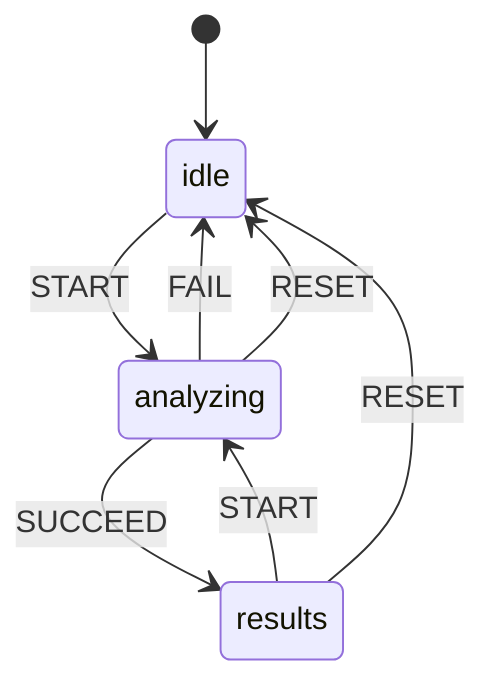
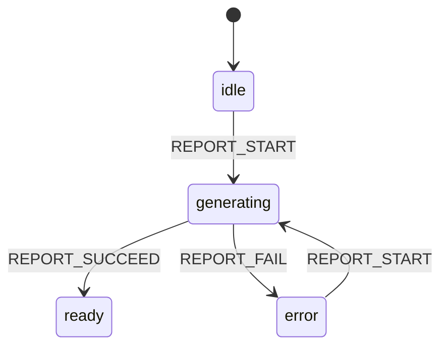
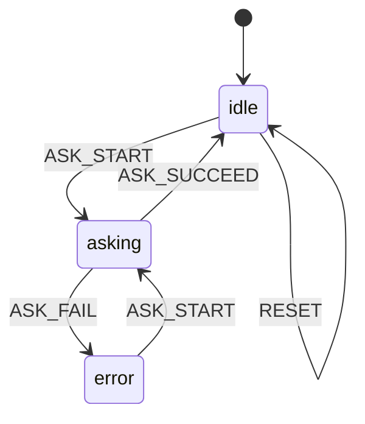
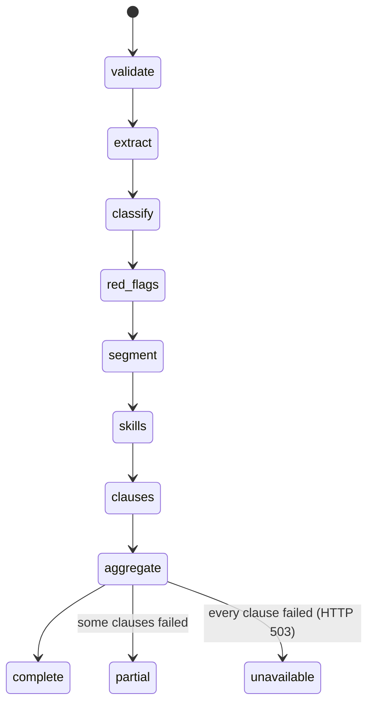
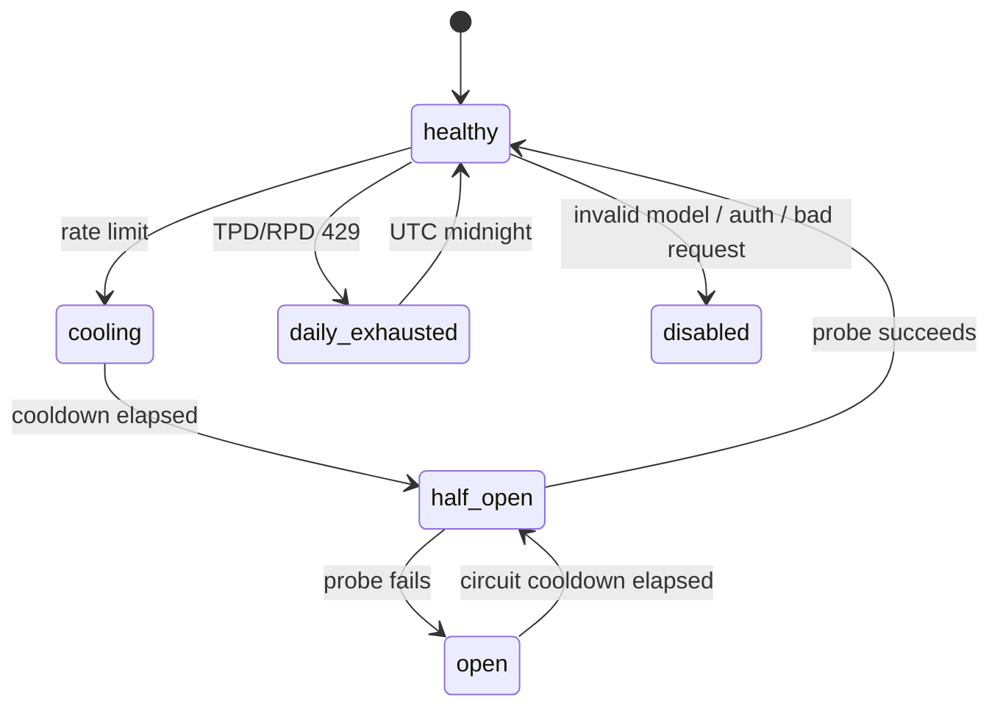

# State machines

This is the inventory of state that used to be inferred from booleans, timers,
or strings scattered across components. The goal is not to turn every `useState`
into a machine; it is to make the states that guard user-visible or
safety-relevant transitions explicit, testable, and inspectable.

## Conventions

- Domain states use a single `status`/`phase` field plus an explicit transition
  table. Impossible combinations should be unrepresentable.
- Asynchronous operations carry a monotonic `runId` (analysis) or `requestId`
  (Q&A). A response from an abandoned operation is ignored.
- Wire values are part of the API contract. Backend values live in
  `backend/app/core/status.py`; the frontend mirrors them in
  `frontend/src/state/analysisMachine.js`.
- The DOM exposes the current state for accessibility and browser agents:
  `data-app-state`, `data-analysis-status`, `data-five-c-status`,
  `data-report-state`, `data-qa-state`, `data-upload-state`,
  `data-clause-status`.

## Analysis journey (explicit)

`frontend/src/state/analysisMachine.js`

`results` carries `outcome: complete | partial`. The backend already computes
that from `failed_clause_count`; the UI no longer re-derives it in three places.
`runId` invalidates an in-flight request when the user selects "Analyze another
contract" or "Upload".

Selectors:

| Selector | Meaning |
|---|---|
| `selectAppState` | `idle`, `idle-error`, `analyzing`, `results-complete`, `results-partial` |
| `selectIsAnalyzing` | Whether the full-screen progress view is active |
| `selectIsPartial` | Whether results should show the partial-analysis notice |
| `selectAnalysisStatus` | `complete`, `partial`, or `unavailable` |

## Report download (explicit sub-machine)

Also in `analysisMachine.js`.

The button is disabled by `generating`; failures remain visible inline instead of
only in a toast.

## Q&A (explicit)

`frontend/src/state/qaMachine.js`

`limit` is derived from `count >= 10`, not a separate flag. `requestId` prevents
an answer for a previous contract from landing in the new contract's history.

## Smaller frontend machines

| Surface | Where | Shape | Notes |
|---|---|---|---|
| Theme | `hooks/useTheme.js` | `dark ⇄ light`, persisted in `localStorage` + `data-theme` | Already explicit; initial value is set by an inline head script to avoid a flash |
| Upload zone | `components/UploadZone.jsx` | `empty → dragging → ready → uploading`, with validation errors | Presentation state; exposed as `data-upload-state` |
| Analysis progress | `components/AnalysisProgress.jsx` | Elapsed-time step schedule | Presentation only. The backend request is synchronous, so this is not telemetry; the schedule is tuned to the Qwen-only runtime |
| Clause register | `components/results/ClauseLedger.jsx` | filter / search / sort / open row | Derived with `useMemo`; not a domain machine |
| 5C and findings rows | `results/RiskBrief.jsx`, `FindingsList.jsx` | open row disclosure | Ephemeral UI state |
| Contract type | `components/ContractTypeSelector.jsx` | `auto` (= `null`) or one of four types | `autoDetect` is derived from the parent value; keeping it local caused desync |
| Toasts / mobile menu / FAQ | `Toast.jsx`, `Navbar.jsx`, `FAQ.jsx` | timed or disclosure states | Local presentation state |
| Error boundary | `components/ErrorBoundary.jsx` | `normal → hasError` | React error boundary reset reloads the page; the fallback exposes `data-app-state="error"` |

## Backend analysis pipeline

`backend/app/core/status.py` defines the stages and wire values. The pipeline is
synchronous, so stages are observable in trace logs rather than streamed to the
client:

| Concept | Values | Where |
|---|---|---|
| Analysis result | `complete`, `partial` | `AnalysisStatus` |
| One clause | `complete`, `failed` | `ClauseStatus` |
| 5C block | `complete`, `partial`, `unavailable` | `FiveCStatus` |
| One 5C row | `Pass`, `Partial`, `Fail`, `Unavailable` | `skill_analyzer.py` |
| Parse quality | `direct`, `recovered`, `heuristic`, `failed`, `empty` | `ParseQuality` |

Each completed stage emits one `pipeline_stage` trace record:
`{event, request_id, stage, status: "complete", ...detail}`. The ordered
sequence is asserted in `backend/tests/test_llm_reliability.py`.

An analysis returns HTTP 503, not a fabricated score, when every clause fails.
A partial result excludes failed clauses from the overall score.

## LLM provider and pacing state (internal, explicit in code)

`backend/app/services/llm_service.py` keeps per-provider state:

- `_ProviderState` holds `consecutive_failures`, `open_until`, `daily_reset_at`,
  and `half_open`.
- Token reservations model the rolling one-minute token window; a reservation is
  released only when the HTTP call did not consume tokens (or after the window
  expires). The scheduler waits or selects another lane instead of stampeding
  the provider.
- `PROVIDER_ORDER` currently contains only `groq` (Qwen). The older fallback
  lanes remain implemented but are not enabled.

## Other backend state

| Surface | States | Behavior |
|---|---|---|
| RAG readiness | sentence-transformer attempt → TF-IDF fallback | The failed encoder load is attempted once per process; the fallback is cached |
| Qdrant | connected / disconnected | Auto-seeded at startup; unavailable RAG degrades to no fair-clause matches, not a failed analysis |
| PDF extraction | PyMuPDF → pdfplumber → `ScannedPDFError` | Garbled/scanned PDFs return HTTP 422 with a plain-language message |
| Report generation | PDF (WeasyPrint) → HTML | Missing native libraries return HTML rather than an error; template render retries with stripped optional context |
| Contract classification | rules → LLM fallback → unknown | Confidence is carried through to the response |
| Rate limiting | sliding 60-second window per IP | `analyze` 5/min, `ask` 10/min, `report` 10/min |

## Tests

- `frontend/src/state/machines.test.js`: transitions, guards, stale-response
  rejection, report sub-machine, and derived Q&A limit. Run with
  `npm run test:state`.
- `backend/tests/test_state_machines.py`: wire-value contract tests and 5C/clause
  state helpers.
